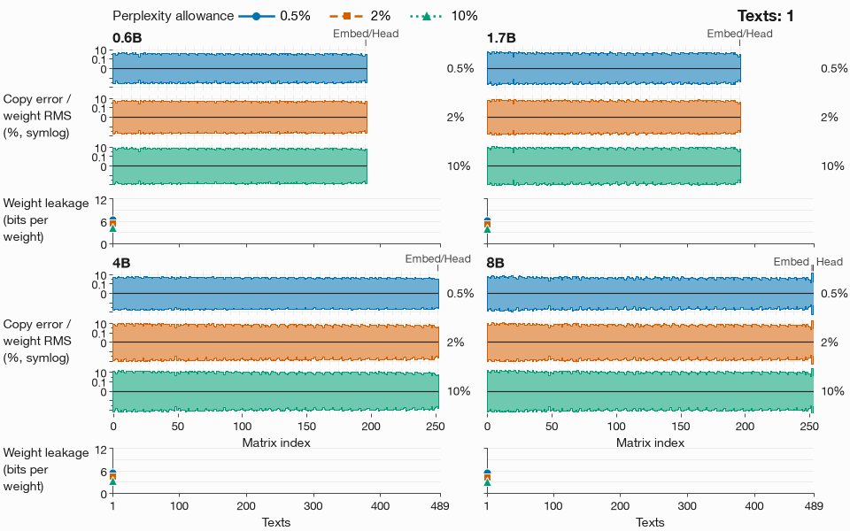
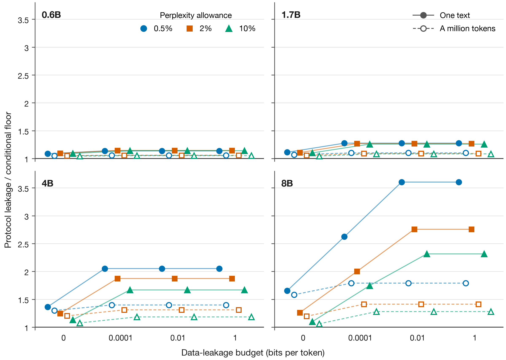
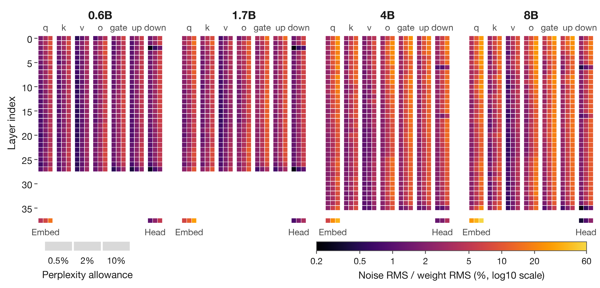

# Know what your optical inference client learns

Sending Qwen3 Base weights as light exposes 5.4 to 6.5 bits per weight after one 2,048-token text while keeping WikiText-2 perplexity within 0.5% of digital BF16. Preliminary simulations. The client's text stays private because nothing returns to the server.

For the 0.6B and 1.7B models, the simple protocol is within about **28% of our conditional minimum after one text**, and **10% after a million tokens**. Under the bound's assumptions, doing much better needs a different kind of protocol, such as one where light returns to the server.

*A real Qwen3-0.6B matrix crop (left) sits beside simulated client copies after 1, 10, 100 and 489 texts at the stored noise level for the 0.5% quality allowance. All five panels share one colour scale; even the one-text copy looks almost identical to the original.*

[Matrix, estimator and error checks](results/README.md#the-clients-copy)

## More use gives the client a sharper copy

After a million tokens, leakage reaches **9.85 to 10.95 bits per weight** at the 0.5% quality allowance. Averaging the repeated copies cuts their expected error by about **22 times** over that span.

The server sends a fresh noisy copy of the weights for each text, so privacy comes at the cost of transmitting the model repeatedly. This no-return protocol, called P0, belongs to the coherent-light weight-delivery family of Sulimany et al., [Quantum-Secure Multiparty Deep Learning, PRX (2025)](https://doi.org/10.1103/k8wg-qmbh).

*Each band shows the expected error in the client's copy of every matrix, shrinking as texts accumulate; no model weights are pictured in this animation. The curves show how much information that copy exposes.*

[Watch the MP4](figures/weight-copy.mp4) · [Read the values and assumptions](results/README.md#the-clients-copy)

## How much room is left to improve?

For the smaller models, protocol leakage divided by the conditional minimum ranges from **1.085 to 1.276 after one text**, and **1.043 to 1.100 after a million tokens**, across every tested quality allowance and data budget. The larger-model bounds leave more room; they do not demonstrate a better protocol.

*Closer to 1 means less room to improve within the protocol family covered by the bound. Filled points show one text and open points a million tokens; colour and shape distinguish the quality allowances.*

[All comparisons and their limits](results/README.md#conditional-floor-gaps)

## Where the noise goes

*Brighter tiles mean more noise in a matrix, with each triplet showing the 0.5%, 2% and 10% quality allowances from left to right. Layers run downwards, and embedding and output-head views sit below them.*

[Every matrix value](results/matrices.csv) · [How to read the map](results/README.md#matrix-noise-map)

A simulated client extracts **99.99% to 100.00%** of the calculated information bound under its Gaussian weight model. A fit using the other three model sizes predicts each held-out model's leakage within **3.1%**. [Attack and prediction evidence](results/README.md#attack-and-size-prediction)

## What this does not show

- A hardware demonstration or an independently checked proof: these are preliminary simulations and conditional arguments.
- A minimum for every optical protocol: the bound assumes fresh, weight-independent errors uniform within each matrix, restricted optical roles and quality assumptions detailed in [THEORY.md](THEORY.md); return-light, shaped-noise and client-encoded-light protocols sit outside it.
- Recovery of a full trained model file: the hero simulates one real crop, and the information attack uses a Gaussian weight model.
- Independent recovery of every floor input: the long-text floors at nonzero data budgets use stored measurements whose activation spectra were not retained; [the limitations](results/README.md#conditional-floor-gaps) also explain the weak larger-model bounds.

## How to use it

Use the [result tables](results/README.md) to compare leakage at your quality target, or start from the [measured runs](data/README.md). [REPRODUCE.md](REPRODUCE.md) gives the commands to check the numbers on a laptop, export figure data or rerun measurements on one GPU. Port the calculation through [optical_inference_leakage](optical_inference_leakage/README.md), retaining the assumptions. Our code, measurements, text and original figures are free to use under [CC0 1.0](LICENSE); the Qwen weight imagery retains [Apache-2.0](figures/QWEN-LICENSE.txt), with [Qwen credit and other third-party terms](THIRD_PARTY.md).
